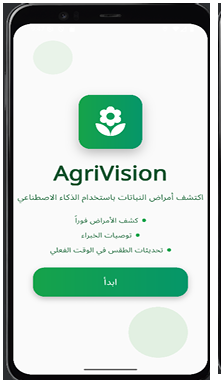
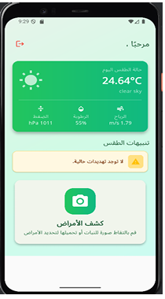
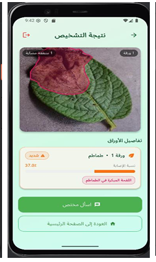
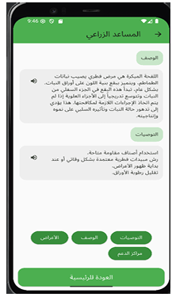

<div align="center">

# 🌱 AgriVision

### Offline-First Edge AI for Crop Disease Detection & Severity Estimation
**YOLO11n instance segmentation · Flutter · TFLite · Arabic RTL · Low-resource agriculture**

[](https://jocc.journals.ekb.eg/article_521612.html)
[](https://www.kaggle.com/datasets/social888/plantdisease/versions/1)


-orange)


</div>

> 📄 **Published in the *Journal of Computing and Communication* (Misr International University), Aug 2026.**
> *AgriVision: An Offline-First Edge AI System for Crop Disease Detection and Severity Estimation Using YOLO-Based Instance Segmentation in Low-Resource Agriculture.*

> ### 🧪 Project status: research prototype
> AgriVision was built as a **graduation project to accompany the paper**. The **on-device diagnosis pipeline** (detection, segmentation, severity estimation, Arabic UI) is implemented and is what the paper evaluates. The **cloud and multi-role modules are work in progress**: the Firebase backend is intentionally **locked (deny-all rules)**, and **no APK is distributed**. To try the app you must build it yourself and connect **your own** Firebase project (see [Getting Started](#-getting-started)). Provided as-is, without warranty, for research and educational use.

---

## Overview

Crop diseases cause an estimated 20–40% of global agricultural losses (FAO), and smallholder farmers, who most need fast diagnosis, often have the least connectivity. Most AI plant-health apps need a constant internet connection and are not localized for Arabic-speaking users.

**AgriVision** is an Android app designed for Egyptian farmers. A farmer photographs a leaf and, **with no internet**, the app:

1. detects the disease class,
2. segments the infected regions and the leaf itself,
3. estimates **severity** from the mask-area ratio,
4. shows the result in **Arabic** (RTL) on top of the annotated image.

When connectivity is available, optional online modules add weather-based disease-risk alerts and an **Arabic text-to-speech chatbot** designed for low-literacy users.

## ✨ Key Features

| | Feature | Status |
|---|---|---|
| 📴 | **Offline-first diagnosis**: full YOLO11n-seg pipeline on-device (≈5.6 MB model) | ✅ Implemented |
| 🍃 | **Instance segmentation**: localizes diseased regions, not just a class label | ✅ Implemented |
| 📊 | **Severity estimation** from disease/leaf mask ratio (Healthy → Critical) | ✅ Implemented |
| 🇪🇬 | **Arabic localization**: RTL UI, Noto Sans Arabic, large icons for outdoor use | ✅ Implemented |
| 🔊 | **Voice chatbot** with Arabic TTS (symptoms, description, treatment) | ✅ Implemented (needs your own API key) |
| 🌦️ | **Weather risk alerts** (GPS + OpenWeatherMap rules) | ✅ Implemented (needs your own API key) |
| 🔐 | **Phone OTP login** for farmers (Firebase Auth) | 🟡 Prototype (test mode) |
| 👥 | **Role-based access** (Farmer / Admin / Agronomist / Support): the role is stored in the Firestore `users` document and the app routes each user to the matching screens | 🟡 Implemented in the app; server-side enforcement planned |
| 🛠️ | **Admin / Agronomist / Support dashboards** | 🟡 Prototype screens; backend locked |
| 🔄 | **Offline cache and cloud sync** | 🟡 Partial; backend locked |
| 🧾 | Session persistence, supplier management, server-side role enforcement (Firestore Security Rules) | 🔜 Planned |

## 🖼️ Screenshots

| Welcome | Farmer Home | Results | Chatbot |
|:---:|:---:|:---:|:---:|
|  |  |  |  |

## 🏗️ System Architecture

```
┌──────────────────────── Android device (offline) ─────────────────────────┐
│  Camera / Gallery → Preprocess (640×640, 0–1, float32)                    │
│        → YOLO11n-seg (TFLite FP16) → NMS → mask decode → polygons         │
│        → Severity = disease_px ∩ leaf_px / leaf_px → Arabic result UI     │
│                          │                                                │
│                 Local cache (results)                                     │
└──────────────────────────┼────────────────────────────────────────────────┘
                           │  when online (optional modules)
        ┌──────────────────┴──────────────────────────────┐
        │ Firebase Auth · Firestore · Sync                │
        │ OpenWeatherMap (risk) · LLM chatbot + Arabic TTS│
        └─────────────────────────────────────────────────┘
```

### On-device inference pipeline
Implemented in `lib/services/ai_diagnosis_service.dart`:

1. Decode image → resize to **640×640** → normalize to `[0,1]` → tensor `[1, 640, 640, 3]`
2. TFLite inference → detections `[1, rowSize, 8400]` + prototype masks `[1, 160, 160, 32]`
3. Confidence filter (**0.10**) → NMS (**IoU 0.45**)
4. Mask = sigmoid(coefficients · prototypes) → bilinear upsample to 640×640 → threshold **0.10**
5. Marching-squares contours → Ramer–Douglas–Peucker simplification (ε = 0.002)
6. Scanline fill + alpha blend overlay on the original image

### Severity estimation

Each disease detection is matched to a leaf of the same crop (bounding-box IoU ≥ 0.05):

```
Severity Ratio = |disease_mask ∩ leaf_mask| / |leaf_mask|
```

| Ratio | Level |
|---|---|
| 0% | Healthy |
| 0–10% | Mild |
| 10–25% | Moderate |
| 25–50% | Severe |
| > 50% | Critical |

## 🌾 Supported Crops & Classes (9)

| Crop | Classes |
|---|---|
| 🍅 Tomato | Early Blight · Leaf Miner · Healthy |
| 🌽 Maize | Fall Armyworm · Leaf Blight · Healthy |
| 🥔 Potato | Late Blight · Pest Damage · Healthy |

## 📦 Dataset

Public on Kaggle: **[AgriVision Dataset](https://www.kaggle.com/datasets/social888/plantdisease/versions/1)**

- **2,019 images** (66.5% field / 33.5% lab), **7,898 polygon annotations**
- Two annotation layers per image: full-leaf polygon + diseased-region polygons
- Semi-automatic labeling: manual seed set → RF-DETR auto-labeling → manual correction (Roboflow)
- Stratified 80/10/10 split by crop × label × environment, seed 42
- Compiled from PlantVillage, PlantDoc, Tomato Leaf Disease Dataset, Potato Leaf Disease (Uncontrolled Environment), Mendeley TLID/PTLID and YEESI. Please respect the licenses of the original sources.

> The dataset is **not** stored in this repository; download it from Kaggle.

## 📈 Results

### Ablation study (PyTorch, test set; 7 phases)

| Model | mAP50 | mAP50-95 | Field mAP50 | Lab mAP50 |
|---|---|---|---|---|
| YOLOv8n-seg (baseline) | 0.587 | 0.375 | 0.526 | 0.751 |
| YOLOv8s-seg (Ph.1) | 0.636 | 0.408 | 0.602 | 0.762 |
| **YOLO26s-seg** (best accuracy) | **0.644** | **0.421** | 0.614 | 0.749 |
| **YOLO11n-seg** (best nano) | 0.633 | 0.405 | 0.582 | 0.766 |

Main findings: architecture, model scale, and augmentation matter most; epochs and resolution matter little; batch 16 beat batch 4; field images are consistently harder than lab images.

### Mobile deployment (TFLite FP16, CPU, Kaggle; relative comparison)

| Model | Seg mAP50 | Size (MB) | Params (M) | Latency (ms) | FPS |
|---|---|---|---|---|---|
| **YOLO11n-seg** ✅ *deployed* | 0.543 | **5.61** | **2.84** | **218.45** | **4.58** |
| YOLOv8n-seg | 0.558 | 6.39 | 3.26 | 270.40 | 3.70 |
| YOLO11s-seg | 0.578 | 19.41 | 10.07 | 448.86 | 2.23 |
| YOLO26s-seg | 0.513 | 20.21 | 10.37 | 676.59 | 1.48 |

**Why YOLO11n-seg?** ~19% faster and ~12% smaller than YOLOv8n-seg for a small accuracy trade-off, the best fit for offline, low-memory phones.

> ⚠️ Latency/FPS are CPU-based relative comparisons. In the Android Studio emulator (virtual Pixel 4), a single lab leaf took ≈2.5 s and multi-leaf field images ≈5 s. Evaluation on physical devices is future work.

## 🧠 Released Model

The model used by the app is **included in this repository**: `assets/models/model_float16.tflite` (YOLO11n-seg, FP16, ~5.6 MB, 640×640 input, 9 classes). It is the exact file loaded by `ai_diagnosis_service.dart`, so the app runs offline diagnosis out of the box. The PyTorch (`.pt`) training weights are not distributed. Because the model was trained with Ultralytics YOLO, it is covered by the AGPL-3.0 license (see [License](#-license)).

## 🗂️ Repository Structure

```
AgriVision/
├── lib/
│   ├── main.dart · routes.dart
│   ├── localization/ar_strings.dart      # Arabic strings (RTL)
│   ├── screens/                          # welcome, login selection, farmer login/signup,
│   │                                     # farmer home, disease detection, results, chatbot,
│   │                                     # admin / agronomist / support dashboards
│   ├── services/                         # ai_diagnosis, auth, offline_cache, connectivity,
│   │                                     # sync / firebase_sync, chatbot, tts, weather_risk
│   ├── utils/  widgets/
├── assets/
│   ├── models/model_float16.tflite       # deployed YOLO11n-seg model (FP16, ~5.6 MB)
│   └── fonts/                            # Noto Sans Arabic
├── android/                              # Android project
├── training/
│   ├── README.md                         # how the research notebooks were run
│   ├── requirements.txt
│   └── notebooks/                        # Phase 1-7 ablation + mobile deployment evaluation
├── firebase/
│   └── firestore.rules                   # deny-all (backend intentionally locked)
├── docs/screenshots/
├── firebase.json · pubspec.yaml · pubspec.lock · analysis_options.yaml
├── .env.example · .gitignore · LICENSE · README.md
```

**Not included on purpose** (see `.gitignore`): `google-services.json`, `lib/firebase_options.dart`, API keys, trained `.pt` weights, dataset images, build output.

## 🚀 Getting Started

> Offline diagnosis needs no API keys, but the app imports the generated Firebase files, so you must generate them for your own Firebase project before it compiles. The original project's backend is locked.

### Prerequisites
- Flutter SDK (stable) and Android Studio / Android SDK
- A Firebase project of your own (Phone Auth + Firestore)
- Optional: OpenWeatherMap and OpenRouter API keys (online modules)

### 1. Clone
```bash
git clone https://github.com/<your-username>/AgriVision.git
cd AgriVision
flutter pub get
```

### 2. Connect your own Firebase project
```bash
dart pub global activate flutterfire_cli
flutterfire configure
```
This generates `lib/firebase_options.dart`. Also place your own `google-services.json` in `android/app/`. Both files are git-ignored. Register your debug SHA-1/SHA-256 in the Firebase console so Phone Auth works.

### 3. Firestore rules
`firebase/firestore.rules` is a **deny-all** placeholder. Write your own rules that enforce the farmer / admin / agronomist / support roles (and stop users from editing their own `role`) before enabling cloud features.

### 4. API keys (optional)
Use `.env.example` as a template and provide your own values (or pass them at build time):
```bash
flutter run \
  --dart-define=OPENWEATHER_API_KEY=your_key \
  --dart-define=OPENROUTER_API_KEY=your_key
```

### 5. Run
```bash
flutter run
```
No APK is distributed with this repository.

## 🧪 Training Notebooks

The `training/notebooks/` folder contains the **research notebooks behind the paper's ablation study** (Phases 1–7 and the mobile deployment evaluation). They were run on Kaggle (2× T4) with the public dataset attached, and are shared as a **research record**, not as a one-click pipeline:

- Run them in phase order; seed = 42.
- Some paths point to private Kaggle models and must be replaced with your own checkpoints.
- Trained `.pt` weights are not distributed. The exported FP16 TFLite model used by the app is included.
- A cleaned, fully reproducible version is planned.

## ✅ Requirements Traceability

| Requirement | Component | Implementation | Status |
|---|---|---|---|
| FR-F1 Farmer OTP registration | Authentication | `farmer_login_page.dart`, `auth_service.dart` | 🟡 Prototype |
| FR-F2 Offline session persistence | Session + Cache | `offline_cache_service.dart` | 🔜 Planned (session manager) |
| FR-F3 Image capture/upload | UI | `disease_detection_page.dart` | ✅ |
| FR-F4 / F5 Offline diagnosis & severity | AI Diagnosis | `ai_diagnosis_service.dart` | ✅ |
| FR-F6 Arabic results display | UI | `disease_results_page.dart` | ✅ |
| FR-F7 / SY2 Connectivity & online features | Connectivity + Sync | `connectivity_service.dart`, `sync_service.dart` | ✅ |
| FR-SY1 Offline operation | AI Diagnosis | `ai_diagnosis_service.dart` (no network calls) | ✅ |
| FR-SY3 Cloud sync | Sync | `firebase_sync_service.dart` | 🟡 Partial (backend locked) |
| FR-A1/G1/S1 Role login, FR-A2 user management | Auth + Admin | `other_user_login_page.dart`, `auth_service.dart`, `admin_dashboard_page.dart` | 🟡 Prototype (role checked in the app, not yet enforced by rules) |
| FR-G2 / G3 Image review, recommendation update | Agronomist | `agronomist_dashboard_page.dart` | 🟡 Prototype |
| FR-S2 Local resource management | Support | `support_dashboard_page.dart` | 🔜 Planned (supplier service) |
| FR-SY4 Secure storage | Firebase Auth + Rules | `auth_service.dart`, `firebase/firestore.rules` | 🔜 Planned (rules that enforce roles server-side; currently deny-all) |

✅ implemented · 🟡 prototype / partial · 🔜 planned

## ⚠️ Limitations

- Trained on 3 crops / 9 classes; field-image accuracy is lower than lab accuracy.
- Evaluated on an emulator; physical-device latency, memory, and energy are not yet measured.
- Cloud modules are incomplete and the backend is locked; no public APK.
- User roles are read from Firestore and applied **in the app only**; they are not yet enforced by server-side Security Rules.
- Chatbot answers are LLM-generated from a curated disease knowledge base. They are decision support, **not** a substitute for an agronomist.
- Weather risk is rule-based.

## 🛣️ Roadmap

- [ ] Server-side role enforcement (Firestore Security Rules) and secure backend
- [ ] Session manager and supplier management
- [ ] Release APK after hardening
- [ ] Real-device benchmarking (latency, memory, battery)
- [ ] More crops, disease classes, and field images
- [ ] INT8 quantization
- [ ] Reproducible training pipeline and configs

## 📚 Citation

**If you use this code, model, or dataset in your work, please cite the paper below.** GitHub's "Cite this repository" button uses `CITATION.cff`.

```bibtex
@article{agrivision2026,
  title   = {AgriVision: An Offline-First Edge AI System for Crop Disease Detection and Severity Estimation Using YOLO-Based Instance Segmentation in Low-Resource Agriculture},
  author  = {Elashmawi, Walaa H. and Kazan, Shahd and Fahmy, Omar M. and Mahfouz, Magi},
  journal = {Journal of Computing and Communication},
  publisher = {Misr International University},
  year    = {2026},
  url     = {https://jocc.journals.ekb.eg/article_521612.html}
}
```

## 📄 License

This project is released under the **[GNU AGPL-3.0](LICENSE)** as a research prototype, **provided as-is without warranty**.

Why AGPL-3.0: the model was trained with [Ultralytics YOLO](https://github.com/ultralytics/ultralytics), which Ultralytics distributes under AGPL-3.0 (trained models included), and the training notebooks use it. Releasing this repository under the same license keeps it consistent with that requirement. Academic and educational use is free.

Third-party components keep their own licenses: Ultralytics YOLO (AGPL-3.0), Noto Sans Arabic (SIL OFL 1.1), Flutter and Firebase packages (see `pubspec.yaml`), and the dataset (Kaggle page terms and the licenses of its source datasets).

## 🙏 Acknowledgements

PlantVillage, PlantDoc, YEESI, and the Mendeley/Kaggle dataset authors · Ultralytics · Roboflow · Flutter & Firebase communities · Misr International University.

## 📬 Contact

<Shahd Kazan> · www.linkedin.com/in/shahd-kazan-255487335
